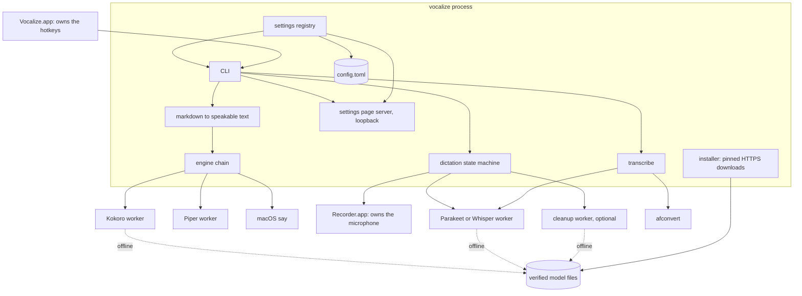
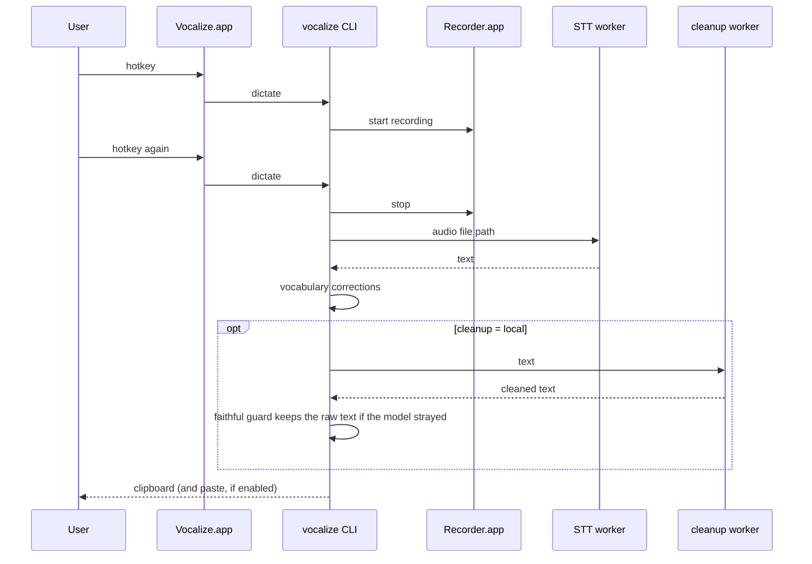

# Design: vocalize, local only

The goal and its authority are in [goal.md](./goal.md). Choices are in
[decisions.md](./decisions.md).

## Context

The work starts from commit `90b5dbc` with `main` merged in (DEC-001). In
that tree the package code already has no cloud provider, no credential
handling and two runtime dependencies (`click`, `tomli`). Checked on
2026-11-21: the only code that opens a network connection is the model
downloader in `vocalize/local/install.py`; the only other sockets are Unix
sockets for the warm servers (`vocalize/local/warm.py`,
`vocalize/local/warm_protocol.py`).

What that tree still has and this design removes: a call-capture module
and its command group, summaries
(`llm.summarize`, `summarize-text`, the notes templates, the summary depths
in `vocalize/speak_options.py`) and the URL gate for the `/speak` skill's
web mode (`hooks/speak_url_gate.py`).

Three facts shape everything else:

1. **Both Swift bundles are frozen.** macOS ties the microphone grant to the
   recorder bundle's signature and the Accessibility grant to the menu-bar
   app's. Any edit to their source re-signs them and costs every user a
   re-grant. The app runs fixed commands and reads fixed lines of
   `vocalize settings`.
2. **Engines run out of process.** Each one is installed from a pinned,
   hash-checked manifest and started under `uv run`, apart from vocalize's
   own environment. That is what keeps a GPL engine and heavy model
   runtimes out of an MIT package with two dependencies.
3. **A worker started without `--offline` can reach the package index.** If
   uv's cache has been pruned, an ordinary `vocalize speak` would fetch
   packages. Local only has to cover that too.

## Approach

- **Remove** call capture and summaries (DEC-002). Keep transcript cleanup as an
  optional stage of dictation, run by the pinned on-device worker (DEC-003).
- **Keep** one pinned worker per engine (DEC-004) and start every one
  offline.
- **Replace** `notes` with `transcribe` (DEC-007).
- **Generate** validation, the config writer, `vocalize settings`, the
  README table and the settings page from one registry of settings
  (DEC-006), with tests that fail when a setting has no control.
- **Size by machine.** A machine profile is a preset the settings page
  applies: it writes ordinary settings and installs models. The owner's Mac
  Studio gets the largest profile.
- **Adopt open-source projects where one does the job better**, each after
  an intake review (DEC-009): Parakeet for dictation (in the base), and
  larger speech models for big machines if they pass measurement. Two
  packages were considered and not adopted: neither `tomlkit` nor
  `pytest-socket` is a dependency. The test suite has its own network
  guard, and the config writer does not keep comments; instead it keeps
  one backup copy of a file before the first save that would lose them.
  Research found the hand-built downloader, settings page server and Swift
  helpers better suited to a local-only tool than the alternatives; they
  stay.

## Structure

Solid arrows are calls. Every worker is a separate process started with
`uv run --offline --no-python-downloads` and an allow-listed environment.
The installer is the only component that uses the network, and only when
the user asks for an install.

## Key flows

Speaking: text is flattened, split into pieces, synthesized by the first
engine in the chain that is ready, cached, and played. A failure before
playback starts falls through to the next engine; after it starts, it does
not.

Transcribing a file: `afconvert` decodes to 16 kHz mono, one worker run
produces timestamped segments, and a Markdown file with frontmatter is
written with mode 0600. Files already processed are skipped.

## Contracts

### Local-only contract

1. No module under `vocalize/` or `hooks/` imports an HTTP client, a hosted
   SDK or `socket` except: `vocalize/local/install.py` (downloads),
   `vocalize/portal.py` (loopback server), and the two warm-server modules
   (Unix sockets). A test holds that list.
2. Every worker command line contains `--offline` and
   `--no-python-downloads`. A test builds each engine's command line and
   checks it.
3. Workers receive an allow-listed environment that sets
   `HF_HUB_OFFLINE=1` and `TRANSFORMERS_OFFLINE=1` and passes no credential
   variables.
4. Model files are downloaded from an address pinned in a manifest to one
   release or revision, over HTTPS; a redirect is followed only to another
   HTTPS address. Every model file is checked against a pinned sha256 and
   size before it is used. Each engine's packages are installed into the
   engine's own environment from a hash-locked list
   (`vocalize/local/locks/`, `uv pip sync --require-hashes --only-binary
   :all:`), with no builds from source. Piper is the exception: its
   packages are pinned by version only, not yet by hash.
5. The test suite runs with network sockets disabled.
6. When a worker cannot start offline, the error says to run
   `vocalize local install` again. It never falls back to the network.

Nothing here can stop an engine package from misbehaving once trusted; that
is what the intake review is for. Running workers under a deny-network
sandbox was measured in Phase 3: Kokoro, Whisper and Parakeet all worked
under `sandbox-exec` with `(deny network*)`, Metal included, but that
profile also blocks the Unix sockets of the warm servers. It is not
adopted in 1.0; see [measurements.md](./measurements.md).

### Commands the menu-bar app depends on

`dictate` (also `--start`, `--stop`), `clip`, `stop`, `listen --cancel`,
`settings`, `portal`. From `vocalize settings` it reads `app.dictate`,
`app.dictate_mode`, `app.speak`, `app.stop` and `stt.paste`. The Speak Quick
Action reads `overflow` and `max_chars`. These lines keep their exact
spelling.

### Settings registry

One module holds a tuple of records. Each record has: key path, type,
default, validator, label, help text, group, control kind (toggle, select,
number, text, chord, device, list, voice), choices or a function that
returns them, a condition for when it applies, what must restart for it to
take effect, whether `vocalize settings` prints it, and for retired keys a
note of what replaces them.

Generated from it: validation on load, the config writer, the
`vocalize settings` output, the README settings table, and the schema the
settings page renders.

Choices that are commands are **actions** in a second tuple: install or
remove each engine, model and voice; install, restart or remove the
menu-bar app; install or remove the Quick Actions and the Claude Code hook;
clear the audio cache; apply a machine profile. Each action has a button or
a written reason why it cannot (the two macOS permission grants can only be
linked to).

### Settings page API

Kept exactly: the one-time code in the URL fragment (60 seconds, single
use, five wrong tries shut the page down), the session token accepted only
in a header, the Host pin to `127.0.0.1:<port>`, refusal of a foreign
Origin, the 64 KiB body cap, the content security policy on every response,
no external script, font or stylesheet, compare-and-swap saves that return
409 when the file changed, and the fifteen-minute idle shutdown.

Changed: `GET /api/schema` returns the registry and the actions.
`POST /api/settings` takes `{changes, fingerprint}`, merges into a fresh
read of the file, validates and saves. `POST /api/action/<name>` starts an
action; long ones report progress through the existing status route. The
per-table save routes go.

### Transcription

`vocalize transcribe PATHS...` accepts audio files, text files and folders.
For each source not already processed it writes
`<folder>/<date>-<slug>.md` with the frontmatter keys notes wrote: title,
date, type, captured, license, topics, source, source_sha256,
duration_seconds, template (`"none"`), transcribed_by, summarized_by
(`"none"`), left_machine (`false`), trust (`"untrusted-transcript"`) and the
vocalize version. The body is a `## Transcript` section of timestamped
lines. `vocalize notes` is a hidden alias that accepts and ignores
`--template` and `--summarizer off`.

### Engines

| Direction | Engine | Runtime (pinned) | Role |
|---|---|---|---|
| Speech out | Kokoro | `kokoro-onnx` 0.6.1 | default |
| Speech out | Piper | `piper-tts` 1.8.0, separate program | opt-in; licence shown before download |
| Speech out | macOS `say` | system | fallback, nothing to download |
| Speech in | Parakeet | `parakeet-mlx` 0.5.2 | dictation default on Apple Silicon when installed |
| Speech in | Whisper | `pywhispercpp` 1.5.1 | file transcription, vocabulary prompt, small Macs |
| Cleanup | Qwen 4B | `mlx-lm` 0.31.3 | optional dictation stage |

Candidates for large machines, each needing an intake review and a passing
measurement before it is offered: Qwen3-ASR 1.7B for accuracy, Parakeet v3
for other languages, and a larger speech-out model (Ming 3.0 or Phonon).
A candidate that does not pass in time is left out and listed as deferred.

### Machine profiles

A profile is chosen from installed memory and can be overridden in the
settings page.

As built (`vocalize/profiles.py`), every profile sets the same five keys,
so applying a smaller profile after a larger one puts each value back.
Applying a profile installs nothing; it names the installs it recommends.
The settings page shows the profile `profiles.detect()` picks from this
Mac's memory and applies one through the `apply_profile` action.

| Profile | Memory | `stt.engine` | `stt.model` | `stt.beam_size` | `stt.warm_minutes` | `stt.cleanup` | Recommended installs |
|---|---|---|---|---|---|---|---|
| small | under 16 GB | `auto` | large-v3-turbo-q5_0 | 5 | 0 | off | Kokoro, Whisper |
| standard | 16 to 31 GB | `parakeet` | large-v3-turbo-q5_0 | 5 | 0 | off | Kokoro, Parakeet, Whisper |
| large | 32 to 63 GB | `parakeet` | large-v3-turbo-q8_0 | 5 | 0 | off | Kokoro, Parakeet, Whisper |
| studio | 64 GB and up | `parakeet` | large-v3-turbo-q8_0 | 5 | 240 | local | Kokoro, Parakeet, cleanup model, and the large-v3-turbo-q8_0 Whisper model for use if the engine is switched to Whisper |

Package defaults stay at the small profile so a first install on any Mac
is safe. Two consequences of the values, worth knowing when they are
revisited: `stt.warm_minutes` keeps only Whisper and the cleanup model
loaded (Parakeet runs one-shot), so in the standard and large profiles it
has no effect while Parakeet is the engine; and `stt.model` and
`stt.beam_size` apply only when Whisper runs, which under these profiles
is when the user switches the engine. The measurements
([measurements.md](./measurements.md)) were taken only on the 128 GB
Mac Studio, so the small, standard and large values remain provisional.

## Decision summary

| # | Decision | Where it shows up |
|---|---|---|
| DEC-001 | Base is `90b5dbc` plus `main` | § Context |
| DEC-002 | Cleanup stays, summaries go | § Approach, § Key flows |
| DEC-003 | Cleanup runs in the pinned worker | § Structure, § Engines |
| DEC-004 | One pinned worker per engine | § Structure, § Local-only contract |
| DEC-005 | Old configs warn and migrate | § Settings registry |
| DEC-006 | One registry drives the UI | § Settings registry, § Settings page API |
| DEC-007 | `transcribe`, `notes` as an alias | § Transcription |
| DEC-008 | Version 1.0.0 | [plan.md](./plan.md) Phase 4 |
| DEC-009 | Intake before new packages | § Engines |

## Testing strategy

- **Unit, no model, no network, no microphone**: everything in `tests/`,
  run with sockets disabled and `HOME` pointed at a temporary folder.
  Workers and the recorder are faked.
- **Structural**: the local-only tests (import allow-list, offline flags on
  every worker command line, dependency policy) and the settings parity
  tests (every key has a control, every key the code reads is registered,
  a config with every key set survives a save, the README table matches).
- **Page**: the existing Node harness drives the page script against a
  stub document, extended to render every control kind from the schema.
- **On the real machine**: the measurements in
  [verification.md](./verification.md) Phase 3, run on the Mac Studio with
  real models. Speech output is checked by transcribing it back and
  counting word errors, because no person listens during the build.
- **Not unit tested**: the two Swift bundles (unchanged), and the two macOS
  permission grants, which only a person can give.
