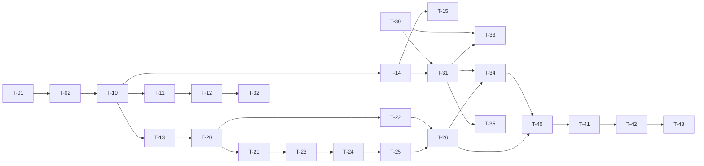

# Plan: vocalize, local only

## Overview

Turn vocalize into a local-only tool that does two things, speech to text
and text to speech, with a settings page that covers every setting, sized
for the owner's Mac Studio, and publish it as 1.0.0. The architecture is in
[design.md](./design.md); the choices behind it are in
[decisions.md](./decisions.md).

## Scope

**In**: removing call capture and summaries; `transcribe`; offline workers and
the tests that hold the local-only contract; the settings registry and a
settings page generated from it; machine profiles and the Mac Studio
configuration; intake reviews and measurements for new engines; docs,
release and installation on the Studio.

**Out**: cloud voices and any hosted model (stay on 0.15 for those);
anything that joins, attends or records a call; summaries; changes to
the two Swift bundles; rewriting the markdown flattener on a parser
library; Windows and Linux.

## Repositories

| Repository | Role | Branch |
|---|---|---|
| the public `vocalize` repository on GitHub | the only repository | `local-only`, squash-merged to `main` |

## Phases

### Phase 0: Base

**Entry criteria**: `main` at `7ce02b1` passes lint and tests (measured:
2542 passed, 6 skipped). Commit `90b5dbc` passes lint and tests (measured:
2360 passed, 6 skipped).

| # | Task | Depends on | Acceptance criteria |
|---|---|---|---|
| T-01 | Merge pull request #29 (tests keep off the real home folder) | — | `origin/main` contains the change; the three required checks are green on it |
| T-02 | Put `local-only` on `90b5dbc` and merge `main` into it | T-01 | `90b5dbc` and `origin/main` are both ancestors of the branch; lint passes; the suite passes |
| T-03 | Commit this plan | T-02 | the plan lint and the decisions lint both exit 0 |

**Exit criteria**: `verify.sh 0` exits 0.

### Phase 1: Two capabilities, nothing leaves the machine

**Entry criteria**: Phase 0 exit.

| # | Task | Depends on | Acceptance criteria |
|---|---|---|---|
| T-10 | Delete the call-capture module, its command group, tests and documents | T-02 | `vocalize --help` lists no call-capture command; no file under `vocalize/`, `hooks/` or `pyproject.toml` contains the removed feature's words; suite passes |
| T-11 | Delete summaries: `summarize-text`, `llm.summarize`, the notes templates, the summary depths in the Speak picker, the `/speak` skill's digest and web modes and `hooks/speak_url_gate.py` | T-10 | `vocalize --help` lists no `summarize-text`; the picker offers speak all and truncate only; `hooks/speak_url_gate.py` is gone; suite passes |
| T-12 | `vocalize transcribe`, with `notes` as a hidden alias and `[transcribe]` reading `[notes]` as its old name | T-11 | transcribing a file writes a note with every frontmatter key in design.md § Transcription; a second run skips it; `vocalize notes FILE --summarizer off` does the same; `vocalize settings` prints `notes.summarizer=off` |
| T-13 | A 0.15 config loads with warnings, not an error | T-10 | a config with a cloud chain, flat `voice`/`model`/`speed`, cloud provider tables and `cleanup = "claude-cli"` loads; each retired key warns once; the chain resolves to local engines; cleanup resolves to `off`; a malformed value for a live key is still an error |
| T-14 | Every worker starts offline with an allow-listed environment | T-10 | for Kokoro, Piper, Parakeet, Whisper and the cleanup worker, the built command line contains `--offline` and `--no-python-downloads`, and the environment sets `HF_HUB_OFFLINE=1` and carries no variable ending in `_KEY` or `_TOKEN`; a worker that cannot start offline produces an error naming `vocalize local install` |
| T-15 | Tests that hold the local-only contract | T-14 | `tests/test_local_only.py` fails if any module outside the allow-list imports an HTTP client or `socket`; the suite passes with network sockets disabled |
| T-16 | Sweep leftovers: unused modules, stale wording in help text and errors | T-11, T-12 | no help text or error message names a removed feature; lint passes |

**Exit criteria**: `verify.sh 1` exits 0.

### Phase 2: A control for every setting

**Entry criteria**: Phase 1 exit.

| # | Task | Depends on | Acceptance criteria |
|---|---|---|---|
| T-20 | The settings registry, with validation generated from it | T-13 | every key the loader accepts is a registry record; the existing config tests pass unchanged except where a retired key is involved |
| T-21 | The config writer generated from the registry | T-20 | a config with every registered key set survives a save byte-for-byte in meaning, including `[speech]`; a save keeps unknown keys |
| T-22 | `vocalize settings` generated from the registry | T-20 | every record marked printed appears; the lines in design.md § Commands the menu-bar app depends on are unchanged |
| T-23 | Page API: schema, one save route, actions | T-21 | `GET /api/schema` returns every record and action; `POST /api/settings` saves with compare-and-swap and returns 409 on a changed file; every route is in the route table the security tests iterate |
| T-24 | The page renders groups and controls from the schema | T-23 | the Node harness renders every control kind and round-trips a change for each |
| T-25 | The missing controls and actions: hotkey chords, input device picker, voices per engine, model manager with per-model remove, integrations, audio cache, machine profile | T-24 | each row of [settings-gaps.md](./settings-gaps.md) has a control or action, or a written exemption |
| T-26 | Parity tests and the generated README table | T-22, T-25 | `tests/test_settings_parity.py` fails when a record has no control, when code reads an unregistered key, or when the README table differs from the generated one |

**Exit criteria**: `verify.sh 2` exits 0.

### Phase 3: Engines and the Mac Studio

**Entry criteria**: Phase 1 exit. Runs alongside Phase 2.

| # | Task | Depends on | Acceptance criteria |
|---|---|---|---|
| T-30 | Intake reviews for each new or upgraded package (DEC-009) | — | an `intake-report.md` with a verdict exists for each; nothing is installed before its verdict |
| T-31 | Measure the shipped engines on the Studio | T-14, T-30 | `measurements.md` records, for Kokoro, Parakeet and Whisper: cold and warm latency, peak memory, and word error rate of speech output transcribed back, with the commands used |
| T-32 | Vocabulary corrections that work for every engine; Parakeet handles long audio | T-12 | a term list corrects a mis-heard term at a word boundary and changes nothing in a 2,000-word plain passage; a 60-minute file transcribes with bounded memory |
| T-33 | Add each candidate engine that passed intake and its thresholds | T-30, T-31 | the engine installs from a pinned manifest, runs offline, and appears in the settings page; a candidate that did not pass is listed in `measurements.md` with the reason |
| T-34 | Machine profiles and the owner's Studio configuration | T-26, T-31 | applying a profile writes only registered keys; `studio-config.toml` loads without warnings |
| T-35 | Cleanup eval on the Studio | T-31 | the existing eval reaches its thresholds (21 of 26 and all adversarial cases) with the pinned model, or cleanup stays off in the Studio profile |

**Exit criteria**: `verify.sh 3` exits 0.

### Phase 4: Release

**Entry criteria**: Phases 1, 2 and 3 exit.

| # | Task | Depends on | Acceptance criteria |
|---|---|---|---|
| T-40 | README, docs, changelog and package metadata for 1.0.0 | T-26, T-34 | no document names a removed feature except the changelog's Removed section; every documented command matches `--help` |
| T-41 | Independent review of the whole change | T-40 | a review file with no open critical or high finding, written by a reviewer who wrote none of the code |
| T-42 | Pull request, checks, squash-merge, build, publish, tag, GitHub release | T-41 | the three required checks are green; the sha256 of each file on PyPI equals the local build; a fresh environment installs 1.0.0 from PyPI and runs `vocalize --version` |
| T-43 | Install on the Mac Studio and apply the Studio profile | T-42 | `vocalize speak` produces audio that transcribes back to the input; `vocalize transcribe` of that audio returns the text; the remaining human steps are listed |

**Exit criteria**: `verify.sh 4` exits 0.

## Dependencies

## Roles

| Role | Works in | Isolation |
|---|---|---|
| Coordinator: plans, runs mechanical steps and every check, commits, merges | the `local-only` worktree | its own worktree; the primary checkout is never touched |
| Implementer: one bounded change with named files and a named test | the same worktree | owns its files for the task; never commits |
| Intake reviewer: reads a package without installing it | a quarantine folder outside the repository | no installs, no execution |
| Reviewer: attacks the plan and later the diff | read-only | wrote none of what it reviews |

## Decisions

See [decisions.md](./decisions.md). Smaller choices, each cheap to reverse:

- Piper stays as an opt-in voice, as the base has it, with its licence
  shown before download.
- The Python floor stays at 3.10, so the three required checks keep their
  names.
- The markdown flattener is not rewritten on a parser library.
- `tomlkit` and `pytest-socket` were not adopted. The writer keeps one
  backup copy before the first save that would drop comments, and the
  suite's own fixture refuses every connection that is not to the Mac
  itself.
- A call-related word in the eval fixtures' sample sentences is test data
  and stays.

## Status (2026-11-21)

`[x]` means the acceptance criteria were checked and the evidence is named.
`[ ]` means the work may be committed but its acceptance was not shown here,
or part of it is missing. The evidence is the four measurement runs in
[measurements.md](./measurements.md) and the independent review (T-41).

- [x] T-10: `vocalize --help` lists no call-capture command; a
  case-insensitive search of `vocalize/`, `hooks/` and `pyproject.toml`
  finds none of the removed feature's words; the module is gone. The
  review repeated the search and found none.
- [x] T-11: `vocalize --help` lists no `summarize-text`;
  `hooks/speak_url_gate.py` and `vocalize/assets/notes` are gone; no
  `summarize` function remains. The review found no summary code.
- [ ] T-12: `vocalize settings` prints `notes.summarizer=off` and the
  `notes` alias exists; Parakeet and Whisper notes were written for real in
  run 3. Running the alias against a folder a 0.15 run processed was not
  shown.
- [x] T-13: the review loaded six 0.15-style config files; each loaded with
  notices, no planted value appeared in any output, and a save removed the
  retired keys.
- [x] T-14: the review read every worker's command line and environment;
  all start with `--offline` and `--no-python-downloads` and an
  allow-listed environment.
- [x] T-15: `tests/test_local_only.py` passes. Its scan's limits are
  written in the test.
- [ ] T-16, T-20 to T-25: committed; the review checked the registry
  against the loader and the page, and found settings with a control that
  did nothing and choices with no control. Those are being closed for
  1.0.0; acceptance is not shown here.
- [x] T-26: `tests/test_settings_parity.py` fails when a record has no
  control the page can render, when code reads an unregistered key, when a
  profile sets an unregistered key, and when the README table differs from
  `settings_registry.readme_table()`; it passes.
- [ ] T-30: intake reports not checked in this status pass.
- [x] T-31: measurements.md records install, disk, speed, memory and word
  error rate for Kokoro, Whisper and Parakeet, warm Whisper, and the
  method, over four runs. Not measured: a true cold start and live
  end-of-recording latency.
- [x] T-32: vocabulary corrections took a technical take from 7.7 % to
  1.5 % on both engines and changed nothing in plain prose (run 3); a
  60 minute file transcribed with Parakeet in 27.6 s. Memory, counted as
  resident memory only, rose from 944 MB at 10 minutes to 1.5 GB at 60.
- [ ] T-33: no candidate engine was added; none is listed as measured.
- [ ] T-34: every profile sets only registered keys with valid values
  (`tests/test_settings_parity.py`); `studio-config.toml` loading without
  warnings is held by `tests/test_profiles.py`, not run in this check.
- [x] T-35: the cleanup evaluation passed on the Studio twice, the second
  time through its runner: 25 of 26 everyday and 10 of 10 guarded cases;
  cleanup stays on in the studio profile.
- [ ] T-40: documents, changelog and metadata are at 1.0.0; the documents
  were corrected after the review. Awaiting the final checks.
- [ ] T-41: the independent review is written. Verdict: ready after the
  listed fixes. Counts: no critical, 2 high, 6 medium, 12 low. Both high
  findings (the missing upgrade note and the sentence order at Parakeet
  chunk joins) are fixed in this release; a re-check of those fixes by the
  reviewer is not shown here.
- [ ] T-42, T-43: not started.
